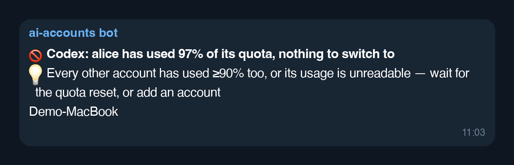
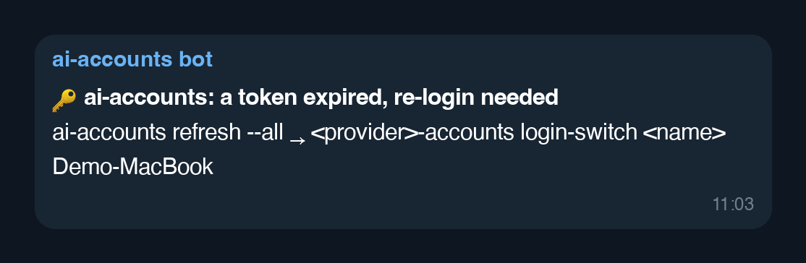
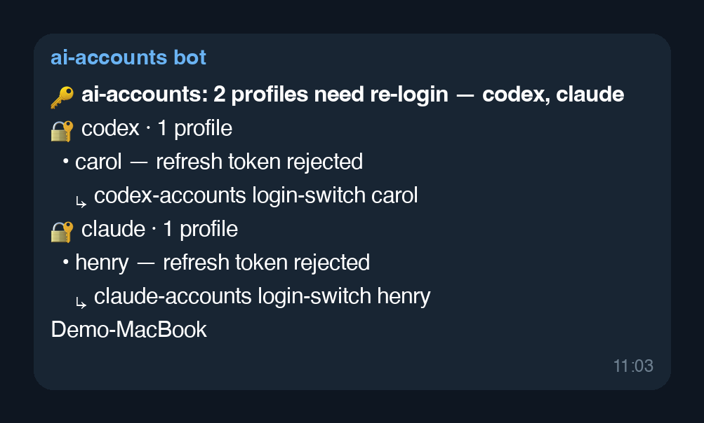
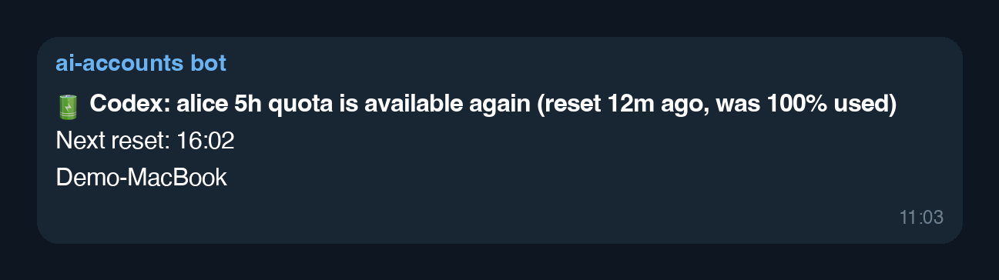
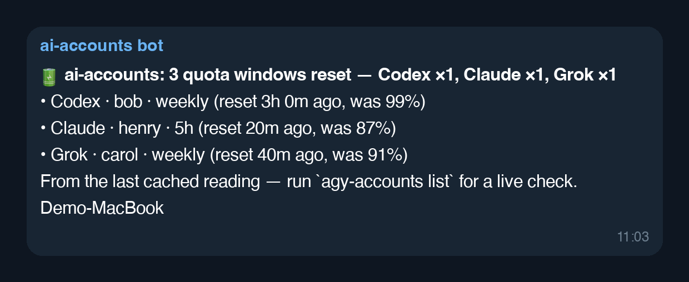
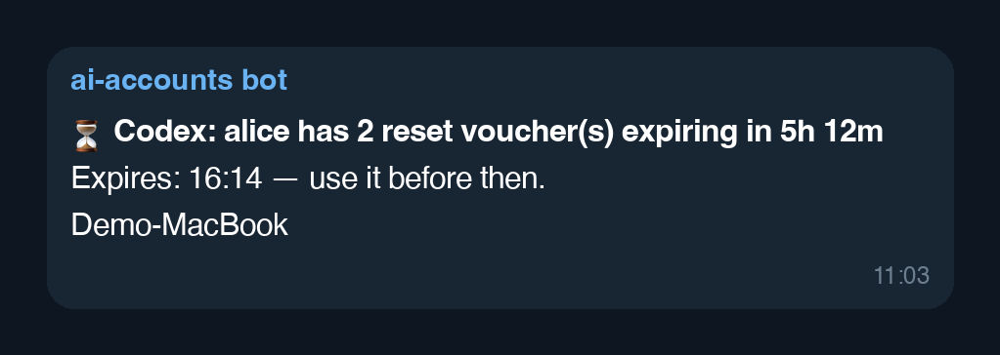
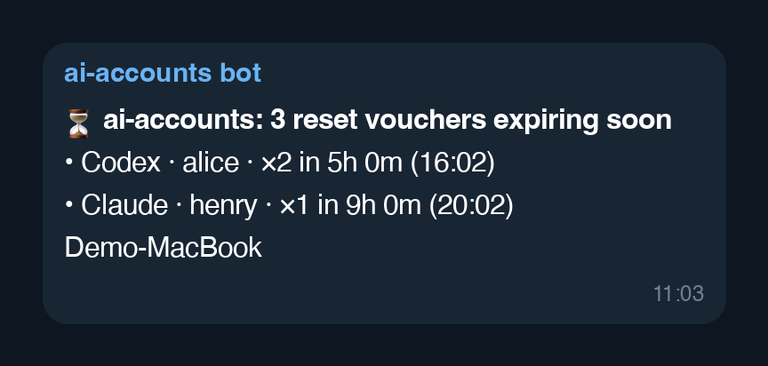

# Telegram notification examples

Every notification type `ai-accounts` sends over the Telegram channel, rendered from the real message templates (`src/ai_accounts/i18n.py`) with fake data (`Demo-MacBook` stands in for the device label). The images are Telegram-style renderings, not screenshots of the app. The two "account switched" messages (1, 2) arrive as a photo with the text as its caption.

## 1. Auto-switch: account switched, session restarted

## 2. Auto-switch: account switched, restart needed

## 3. Auto-switch: no account to switch to

## 4. Token expired (generic fallback)

## 5. Token expired (grouped by provider)

## 6. Quota reset (single window)

## 7. Quota reset (several windows)

## 8. Reset voucher expiring (single)

## 9. Reset voucher expiring (several)

